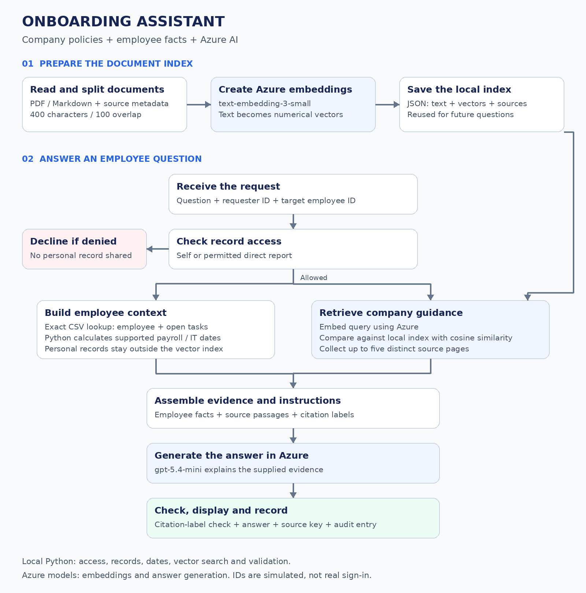

# Onboarding RAG Assistant

### Employee guidance grounded in company policies and records

**Author:** Yahya · **Scenario:** Al Dana Group · **Status:** Learning prototype

[Architecture](#️-architecture--pipeline) ·
[How to run](#-how-to-run) ·
[Results](Results.md)

---

## 📌 Project Overview

New employees often need several documents and different teams to
understand what they should do next.

This assistant brings that information together. It answers questions
about equipment, HSE induction, payroll, probation and outstanding
onboarding tasks using the supplied fictional company dataset.

The project uses **Retrieval-Augmented Generation (RAG)**: it retrieves
supporting information before asking a language model to explain it.

| Project detail | Description |
|---|---|
| Users | New employees and permitted managers |
| Interface | Python command line |
| AI platform | Azure-hosted model deployments |
| Policy sources | PDF and Markdown documents |
| Employee information | Structured CSV records |
| Vector storage | Local JSON index |
| Purpose | Provide onboarding guidance with source references |

The assistant does not complete tasks, send requests or change HR records.

---

## 🎯 What the Assistant Helps With

| Question | Information needed |
|---|---|
| What remains open for me? | Recorded tasks, owners, deadlines and statuses |
| When is my first salary scheduled? | Joining date, payroll rules and calendar |
| Do I receive a laptop? | Equipment policy, grade and location |
| When must I complete HSE induction? | Site requirements and recorded tasks |
| What happens during probation? | Duration, check-ins, review and decision rules |
| Can I see another employee's tasks? | Access rules and reporting relationships |

---

## 🏗️ Architecture & Pipeline



[Open the full-size architecture diagram](architecture.png)

### Workflow A: Prepare the knowledge base

1. Read the selected PDF and Markdown documents.
2. Extract text and preserve source metadata.
3. Split the text into overlapping chunks.
4. Send those chunks to the Azure embedding deployment.
5. Save vectors, text and metadata in a local index.

An **embedding** is a numerical representation used to compare text by
meaning. Saving embeddings avoids processing every document again for
each question.

### Workflow B: Answer a question

1. Check whether the requester may access the target employee.
2. Load permitted employee records and calculate supported dates.
3. For recognized record-only requests, render the relevant facts directly.
4. Otherwise, search the document index for relevant evidence.
5. Give the evidence and permitted context to the Azure answering model.
6. Validate source labels, render selected task fields and return the answer.

The record-only route supports limited question patterns. Other wording
continues through document retrieval and model generation.

### Three different responsibilities

| Component | Responsibility |
|---|---|
| Python | Access rules, exact records, task tables and date calculations |
| Embedding model | Locate potentially relevant document passages |
| Answering model | Explain the supplied policy evidence |

**RAG does not train the answering model on these documents. It supplies
evidence when a question is asked.**

---

## ⚙️ Core System Layers

### 1. Request and access control

**Files:** `ask.py`, `onboarding/records.py`

Requests include an asker ID, target employee ID and question.

The prototype permits self-access and access to a manager's direct
report. Unauthorized requests are declined. Recognized requests naming
another employee without a suitable target require clarification.

Access decisions belong in code, not in the language model.

**Boundary:** command-line IDs simulate identity. A user entering an ID
is not authenticated as that person.

### 2. Employee context and business rules

**File:** `onboarding/records.py`

Employee records are read directly from CSV files rather than searched
by vector similarity.

Python supplies recorded tasks and supported payroll and IT dates.
Task tables preserve the task name, owner, due date and status together.
Blocker notes and manager equipment-request deadlines are kept separate
from unrelated tasks.

The default scenario date is **16 October 2026**. Use `--today` to
explicitly change the reference date for a question.

### 3. Document preparation and embeddings

**Files:** `onboarding/documents.py`, `build_index.py`

Document-selection rules exclude superseded material. Prepared chunks
retain source information so retrieved text can be traced back to a file.

The selected configuration uses **400-character chunks with
100-character overlap**. Overlap helps retain context across boundaries.

The embedding deployment is `text-embedding-3-small`. Vectors are stored in:

`artifacts/vector-index.json`

This is a local index for a small dataset, not a managed vector database.
Extracted tables and Arabic text need inspection before relying on them.

### 4. Evidence retrieval

**File:** `ask.py`

The default search embeds the question and compares it with stored
vectors using **cosine similarity**, a measure of vector similarity.

Supported broad task searches include open-task names as extra context.
The application selects up to five distinct source pages to reduce
repeated evidence from the same page.

Optional hybrid search combines keyword and vector retrieval.
Optional model reranking reorders candidate evidence and adds an Azure
model call. Neither option has a demonstrated improvement in the final
results reported here.

### 5. Answer generation

**File:** `ask.py`

The application calls the `gpt-5.4-mini` Azure deployment through the
native OpenAI Python SDK.

The model receives the question, permitted employee context, retrieved
passages and answering instructions. Instructions cover completeness,
policy precedence, missing information and avoiding unsolicited offers.

Python renders selected task fields. The model writes the explanation.

This implementation uses model API calls; it does not depend on
Microsoft Agent Framework or a hosted Foundry agent.

### 6. Validation and evaluation

**Files:** `ask.py`, `evaluate.py`, `tests/`

Citation checks verify that referenced labels exist. They do not verify
that every claim is supported by the cited passage.

Weekday correction, payroll fallback and IT-conflict correction are
tested safety nets. The main grounding comes from supplied records,
calculated facts and retrieved documents.

Unit tests check code behavior. Evaluation runs save generated answers
and retrieval diagnostics for review against expected points.

---

## 🧰 Technology Stack

| Component | Technology |
|---|---|
| Application | Python |
| Model client | Native OpenAI Python SDK |
| Model hosting | Microsoft Azure |
| Answering deployment | `gpt-5.4-mini` |
| Embedding deployment | `text-embedding-3-small` |
| Employee records | CSV |
| Document index | Local JSON |
| Tests | Python `unittest` |

The application, access rules and index run locally. Model requests are
sent to Azure. Deployment names can be changed through configuration.

---

## 🔨 Development Process

1. Separated employee records from policy documents.
2. Added record-access checks and Python date calculations.
3. Prepared document chunks and generated embeddings.
4. Compared 400-character and 800-character chunk configurations.
5. Added distinct-page retrieval, source labels and answering instructions.
6. Evaluated the supplied development questions.
7. Applied mentor feedback on task rendering, configuration and testing.
8. Added ten additional questions and saved expected-point reviews.
9. Documented remaining failures instead of treating successful execution
   as proof of correct answers.

---

## 📊 Evaluation & Findings

Latest recorded verification, **29 October 2026**:

| Check | Result |
|---|---|
| Local unit tests | 35 passed |
| Development cases without runtime errors | 14/15 |
| Additional cases without runtime errors | 10/10 |
| Additional-question expected-point coverage | 26/29 — 89.7% |

DEV-06 failed with a JSON parsing error and answered on a separate retry.
The original failed result remains in the saved evaluation.

Expected-point scoring is AI-assisted and requires author verification.
It is not an overall accuracy score. The additional questions have now
informed development and are no longer an untouched held-out set.

See **[Results.md](Results.md)** for saved report locations, missing points,
targeted checks and remaining limitations.

---

## 🚀 How to Run

Run these commands from the project folder in Windows PowerShell.

### 1. Create the environment and install dependencies

Python 3.12 was used for development.

```powershell
python -m venv .venv
.\.venv\Scripts\python.exe -m pip install -r requirements.txt
```

### 2. Configure Azure

Configuration is shared through `onboarding/config.py`.

| Environment variable | Purpose |
|---|---|
| `AZURE_OPENAI_ENDPOINT` | Azure OpenAI-compatible endpoint |
| `AZURE_OPENAI_CHAT_DEPLOYMENT` | Answering deployment name |
| `AZURE_OPENAI_EMBEDDING_DEPLOYMENT` | Embedding deployment name |
| `AZURE_OPENAI_API_KEY` | Optional key; otherwise entered at the prompt |

The code retains project defaults. For your own resource, replace the
example values below with your endpoint and deployed model names:

```powershell
$env:AZURE_OPENAI_ENDPOINT = "https://YOUR-RESOURCE.services.ai.azure.com/openai/v1/"
$env:AZURE_OPENAI_CHAT_DEPLOYMENT = "YOUR-CHAT-DEPLOYMENT"
$env:AZURE_OPENAI_EMBEDDING_DEPLOYMENT = "YOUR-EMBEDDING-DEPLOYMENT"
```

These settings apply to the current terminal session. Do not commit API
keys to the repository.

Check the connection:

```powershell
.\.venv\Scripts\python.exe check_azure.py
```

### 3. Run local tests

```powershell
.\.venv\Scripts\python.exe -m unittest discover -s tests -v
```

### 4. Prepare documents and build the index

For a fresh checkout without a compatible index:

```powershell
.\.venv\Scripts\python.exe -m onboarding prepare --size 400 --overlap 100
.\.venv\Scripts\python.exe build_index.py --size 400
```

Inspect extracted text before embedding. Building the index makes billed
Azure embedding requests. Reuse a compatible existing index rather than
rebuilding it for every question.

### 5. Ask a question

```powershell
.\.venv\Scripts\python.exe ask.py --asker NH-2606 --target NH-2606 --question "When will I get my first salary?"
```

Check the unauthorized-record behavior:

```powershell
.\.venv\Scripts\python.exe ask.py --asker NH-2606 --target NH-2610 --question "What tasks are still open?"
```

Check recorded tasks and the separate manager deadline:

```powershell
.\.venv\Scripts\python.exe ask.py --asker E1084 --target NH-2610 --question "What onboarding tasks remain open for my direct report, and when must I request their equipment?"
```

### 6. Run evaluations when needed

These commands make billed Azure requests:

```powershell
.\.venv\Scripts\python.exe evaluate.py --suite dev
.\.venv\Scripts\python.exe evaluate.py --suite fresh
```

Read the generated `review.md` and saved answers. Verify each expected
point against the evidence before completing `scores.csv`.

Optional retrieval experiments:

```powershell
.\.venv\Scripts\python.exe evaluate.py --suite fresh --search hybrid
.\.venv\Scripts\python.exe evaluate.py --suite fresh --search hybrid --rerank
```

Existing reports can be reviewed without rerunning the evaluations.

---

## 📁 Repository Guide

| Path | Purpose |
|---|---|
| `ask.py` | Request handling, retrieval and answer generation |
| `build_index.py` | Embeddings and index creation |
| `check_azure.py` | Azure connection check |
| `evaluate.py` | Evaluation runs and saved review material |
| `onboarding/config.py` | Shared Azure settings |
| `onboarding/records.py` | Records, access rules and date calculations |
| `onboarding/documents.py` | Document processing |
| `data/` | Fictional documents, records and evaluation data |
| `tests/` | Automated tests |
| `artifacts/` | Local generated files and selected saved reports |
| `architecture.png` | Architecture illustration |
| `requirements.txt` | Python dependencies |
| `Results.md` | Results, evidence and limitations |

Keep credentials and virtual environments out of version control.
Review generated logs before sharing them because they can contain
questions and employee context.

---

## 🛠️ Lessons and Current Limitations

- Exact record fields and dates are more reliable when handled in code.
- Retrieving a relevant document does not guarantee a complete answer.
- Valid citation labels do not prove factual support.
- Answers can still omit details, contradict themselves or add unrelated advice.
- JSON output parsing can fail even after an earlier successful request.
- Recognizing a few record-only question patterns does not cover every paraphrase.
- CLI identities are simulated; production use requires real authentication
  and server-enforced authorization.
- The local index suits this small prototype dataset.
- There is no web interface, voice input, Teams integration or live HR update.

The next priorities are to verify the assisted scoring, address the
documented answer failures and improve output-format reliability.