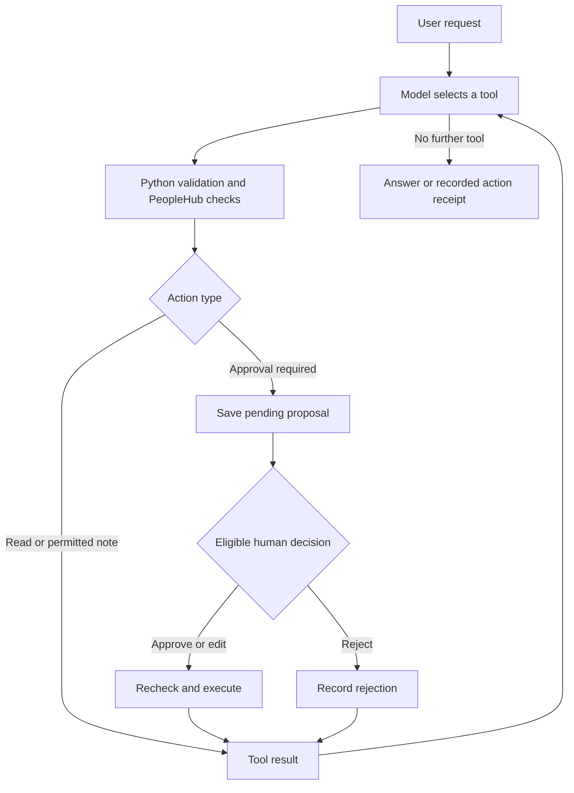

# 🤖 Onboarding Action Agent

### From answering questions to taking controlled actions

**Author:** Yahya AlBashtawi · **Organisation:** Cerebrum
**Scenario:** Fictional Al Dana onboarding · **Status:** Learning prototype

[📊 Evaluation report](RESULTS.md) · [📘 API reference](docs/ONB_API.md) · [🧪 Unit tests](tests/test_approval.py) · [🔙 Phase 1](../README.md)

---

## 📌 Project overview

Onboarding involves more than finding information. Employees and managers
also need to resolve blockers, request equipment and arrange appointments.

This Python agent interprets natural-language requests, consults PeopleHub
records and uses tools to perform permitted operations. Actions requiring
approval are saved as proposals and remain unexecuted until an eligible
person approves them.

> **Core principle:** the model selects tools; Python validates arguments
> and enforces approval; PeopleHub checks permissions and business rules.

All operations use the supplied **mock PeopleHub system**. No real HR
records are changed, appointments booked or emails delivered externally.

## 🎯 Example: requesting a laptop

**Manager:** “Please request a laptop for the new hire. HR already agreed.”

| Step | Agent behaviour |
|---|---|
| 🔎 Identify | Locate the intended employee and read their onboarding record |
| ✅ Check | Verify access and laptop eligibility through PeopleHub |
| 📝 Propose | Save the exact request and eligible approvers |
| ⏸️ Wait | Return `awaiting_approval`; create no IT request yet |
| 👤 Decide | Accept an eligible person's approval, rejection or permitted edit |
| ⚙️ Execute | Recheck a newly approved action, then create the mock request |
| 📋 Report | Return the actual execution result or failure |

A claim that approval happened by phone does not replace the recorded
approval workflow.

## 🔄 Phase 1 → Phase 2

| Area | Phase 1: RAG assistant | Phase 2: action agent |
|---|---|---|
| Purpose | Answer onboarding questions | Perform controlled onboarding operations |
| Information | Retrieved documents and authorized CSV records | PeopleHub tools and operational records |
| Output | Explanation with source citations | Explanation, pending proposal or execution result |
| Writes | No HR record updates | Permitted writes to the mock system |
| Human control | User reviews an answer | Eligible person approves, rejects or edits gated actions |
| Evaluation | Retrieval and expected-answer points | Calls, approvals, database effects and recovery |

Phase 1 remains in the repository root. Phase 2 runs separately in this
folder; the document-retrieval pipeline is not integrated into this agent.

## 🧰 Supported operations

| Operation | Approval behaviour |
|---|---|
| Read onboarding records and blockers | Read-only, subject to access checks |
| Create an IT account, laptop or equipment request | Eligibility checks and human approval |
| Book a medical or QID appointment | Applicability, slot checks and human approval |
| Send an onboarding email to a permitted recipient | Validation and human approval |
| Add a task note | Authorized low-risk write; no approval request |
| Reject a pending proposal | No action executed |
| Modify a proposal | Permitted fields validated and eligibility checked again |

## 🏗️ Architecture

| Component | Responsibility |
|---|---|
| **CLI** | Receives messages, conversation IDs and simulated identities |
| **Azure-hosted model** | Interprets requests and chooses tools |
| **OpenAI SDK** | Exchanges messages and tool calls with the deployment |
| **Pydantic** | Validates types, allowed values and unexpected arguments |
| **Python controller** | Manages proposals, approvers, execution and recovery |
| **PeopleHub APIs** | Apply access checks and onboarding business rules |
| **Persistent state** | Retains conversation and pending execution information |
| **Evaluation harness** | Checks conversations, approvals, API calls and effects |

### 🛡️ Human in the loop

Human in the loop means a person remains part of the execution decision.

- **Approve:** verify the approver and execute the eligible action.
- **Reject:** finish without performing the proposed write.
- **Modify:** validate permitted edits and recheck the changed proposal.
- **Unauthorized decision:** do not execute the action.

Approver identity comes from the `resume` command, not model arguments.
CLI identities are simulated for this exercise, not production authentication.

## 🔁 Reliability and recovery

| Control | Purpose |
|---|---|
| Persistent pending state | Resume approval in a separate process |
| Execution details saved before writing | Support recovery after interruption |
| Stable idempotency keys for approved writes | Reuse the same operation identity on retry |
| One retry for retryable service errors | Handle a temporary failure without an unlimited loop |
| Per-thread locking | Protect simultaneous updates to one conversation |
| Exact task-note argument tracking | Avoid repeating the same note within that thread |
| Explicit failure reporting | Avoid presenting failed actions as completed |

These controls have targeted test coverage. They do not establish a
universal exactly-once guarantee across every tool and failure mode.

## 📊 Verification — 8 November 2026

| Revision | Evidence | Result |
|---|---|---|
| Original submission | Mentor reproduced public and additional evaluations | 24/24 + 12/12 live runs; 20/20 units |
| First review update | Uploaded live reports and Windows terminal output | 42/42 live runs; 38/38 units; 0 reported safety violations |
| Current action-summary update | Offline regression suite | **42/42 unit tests** |
| Current action-summary update | Public, additional and expanded review live suites | **51/51 live runs; 0 reported safety violations** |

Passing scenario checks did not catch every inaccurate sentence. The current
update generates final action receipts from saved execution results, preserving
human rejection reasons, recorded status and correct appointment weekdays.

[Full results and evidence](RESULTS.md) · [Review notes](CHANGELOG.md)

---

## ⚙️ Installation

**Tested environment:** Windows PowerShell · Python **3.12.10**

Open a terminal in the repository's `phase2` folder:

```powershell
python -m venv .venv
.\.venv\Scripts\python.exe -m pip install -r requirements.txt
```

On first setup only:

```powershell
Copy-Item .env.example .env
notepad .env
```

| Configuration variable | Required value |
|---|---|
| `AZURE_OPENAI_ENDPOINT` | Azure resource endpoint |
| `AZURE_OPENAI_API_KEY` | Your private API key |
| `AZURE_OPENAI_DEPLOYMENT` | Tool-capable deployment name |

For the supplied deployment checker, use the resource endpoint without
an appended `/openai/v1` path. Never commit your `.env`.

### 🌐 Windows Unicode support

Run in each new PowerShell terminal:

```powershell
$env:PYTHONUTF8 = "1"
$env:PYTHONIOENCODING = "utf-8"
```

This allows the supplied harness to save Unicode responses reliably.
Agent JSON output uses ASCII escapes, preserving the decoded text.

### 🔌 Deployment check

This makes a **billable model request**:

```powershell
.\.venv\Scripts\python.exe -X utf8 tools\check_model.py
```

## 🧪 Run verification

### 1. Local unit tests — no Azure calls

```powershell
.\.venv\Scripts\python.exe -X utf8 -m unittest discover -s tests -v
```

### 2. Public scenarios — Azure calls are billed

```powershell
.\.venv\Scripts\python.exe -X utf8 harness\run_scenarios.py --track onboarding --agent ".venv/Scripts/python.exe agent_cli.py" --scenarios scenarios/onboarding_public.jsonl --repeat 3 -v --keep --out results-public-repeat3.json
```

### 3. Additional scenarios — Azure calls are billed

```powershell
.\.venv\Scripts\python.exe -X utf8 harness\run_scenarios.py --track onboarding --agent ".venv/Scripts/python.exe agent_cli.py" --scenarios scenarios/onboarding_own.jsonl --repeat 3 -v --keep --out results-own-repeat3-utf8.json
```

The harness supplies isolated databases and state directories using
`PEOPLEHUB_DB` and `AGENT_STATE_DIR`.

## 💬 CLI interface

Invoke `agent_cli.py` using these command arguments:

| Command | Purpose |
|---|---|
| `start --thread ID --user ID --message TEXT` | Begin a conversation |
| `say --thread ID --message TEXT` | Continue a conversation |
| `resume --thread ID --decision approve --by ID` | Approve |
| `resume --thread ID --decision reject --by ID` | Reject |
| `resume --thread ID --decision modify --by ID --edit JSON` | Approve permitted edits |

Each invocation returns one JSON object containing `status`, `message`
and `pending`. Status is `done`, `awaiting_approval` or `error`.
Preserve the same thread's saved state between proposal and decision.

## 📁 Repository guide

| Path | Purpose |
|---|---|
| `agent_cli.py` | Model loop, validation, approval and recovery |
| `peoplehub/` | Supplied mock APIs and fictional seed records |
| `harness/` | Supplied scenario runner |
| `docs/ONB_API.md` | PeopleHub API documentation |
| `scenarios/onboarding_public.jsonl` | Eight supplied scenarios |
| `scenarios/onboarding_own.jsonl` | Four additional scenarios |
| `tests/test_approval.py` | Twenty local tests |
| `results-public-repeat3.json` | Public evaluation evidence |
| `results-own-repeat3-utf8.json` | Successful additional evaluation evidence |
| `RESULTS.md` | Results, failure analysis and limitations |
| `PRECOMMIT_REVIEW.md` | Secret-check scope and earlier hash findings |
| `templates/` | Supplied templates, not completed peer reviews |

## 🎬 Suggested 10-minute demonstration

| Time | Demonstration |
|---|---|
| 0–2 minutes | Explain the goal and identify a blocked contract |
| 2–4 minutes | Propose a laptop request; show that execution waits |
| 4–6 minutes | Demonstrate an eligible decision and its actual effect |
| 6–8 minutes | Show rejection or a controlled service failure |
| 8–10 minutes | Explain tests, recovery design and limitations |

Use the saved evaluation evidence as a fallback if the model service is
unavailable. A failure demonstration should explain what happened and
show that the system did not claim a successful write.

## 🔐 Precommit checks

From `phase2`:

```powershell
.\.venv\Scripts\python.exe -X utf8 tools\precommit_check.py
```

This scans Phase 2. Earlier repository-wide findings in Phase 1 hash
metadata are documented in [PRECOMMIT_REVIEW.md](PRECOMMIT_REVIEW.md).
The supplied checker remains unchanged.

## ⚠️ Current limitations

- Identity is simulated; production authentication is not implemented.
- The backend is a mock system and the interface is command-line only.
- Multi-action continuation passed the first review live suite. The current update passed all 15 workflow runs.
- Task-note duplicate tracking covers exact arguments within one thread.
- Model-written explanations can still vary or include unsolicited offers. The rigid prompt-only promise of no follow-up offers was removed; this cosmetic behaviour is not guaranteed.
- Mentor review on 8 November reproduced the original scores and reported 17/18 unseen runs passing. Those scores do not validate this revised code.
- Phase 1 RAG and Phase 2 actions remain separate workflows.

## 📌 Review status

Mentor review has been received and fixes are in progress. See `CHANGELOG.md` for the revised validation and remaining steps. A review of a teammate's PR and the demonstration remain separate delivery steps.

## 🔄 Request and approval flow



Every new sensitive action requires its own approval. The controller records
an action's outcome before asking the model to continue, so a model connection
failure can be retried without replaying the completed write.

## Mentor-review revision: continuation and recipient handling

After an approve, reject or failed action, the agent records the tool result and
continues the original conversation. Resolved actions cannot be proposed again
within the same user request. A new `say` starts a new request.

If a model call fails after a write, the response preserves the completed outcome
and explicitly says remaining actions are unresolved. Repeat `resume` to continue;
the completed write is not replayed. Each `resume` answers the CURRENT proposal:
inspect the returned pending action before sending another approval.

Human messages show employee names, action details and approver names. JSON
arguments remain in `pending` for the harness. Approver display names use the
supplied seed directory, with the live manager name preferred; names do not grant
permission. IDs from live PeopleHub checks remain authoritative.

Emails to the hire must use the recorded work email. For another recipient,
this revision conservatively requires the user to specify the exact address;
a team name alone may need clarification. API address restrictions still apply.
An approver cannot silently redirect an email to a different recipient.

Arabic requests receive Arabic approval/status labels. Proper names, API reasons,
and some operational labels may remain English; complete localization is not claimed.

A forbidden read ends the current turn in code. This prevents a second forbidden
API attempt, but also stops unrelated work in that turn and reports it as unresolved.

While approval is pending, `say` returns the existing proposal: requesters cannot
cancel it with conversational text. An eligible approver must use `resume --decision reject`.
The agent has no tool for cancelling a request that is already executed.

### Linux and macOS

Run from `phase2` (Python 3.12 recommended):

```bash
python3 -m venv .venv
source .venv/bin/activate
python -m pip install -r requirements.txt
cp .env.example .env  # first setup only; enter credentials locally
python -m unittest discover -s tests -v
```

Live runs use Azure and are billed:

```bash
python harness/run_scenarios.py --track onboarding --agent "python agent_cli.py" --scenarios scenarios/onboarding_public.jsonl --repeat 3 --out results-public-review.json
python harness/run_scenarios.py --track onboarding --agent "python agent_cli.py" --scenarios scenarios/onboarding_own.jsonl --repeat 3 --out results-own-review.json
python harness/run_scenarios.py --track onboarding --agent "python agent_cli.py" --scenarios scenarios/onboarding_review.jsonl --repeat 3 --out results-review-new.json
```

## 📋 Accurate action receipts

After a turn resolves approved or rejected actions, the final receipt uses
saved outcomes instead of a model-written paraphrase. Human rejection is
attributed to the approver; request IDs and status come from PeopleHub;
appointment weekdays are calculated from the returned date.

Read-only turns still use model answers. For mixed requests, the final receipt
covers recorded actions; ask separate informational questions in their own
message. It does not claim every possible part of a request was answered.

The 22 conversation tests in [test_conversation.py](tests/test_conversation.py)
include deliberately misleading model replies. The 20 approval and recovery
tests remain in [test_approval.py](tests/test_approval.py).

## Verified results — 9 November 2026

The latest published reports record **51/51 live scenario runs passing**:
24/24 public, 12/12 additional and 15/15 workflow runs, with **zero
reported safety violations**. Windows terminal output records **42/42
unit tests passing**.

- [Public results](results-public-latest.json)
- [Additional results](results-additional-latest.json)
- [Workflow results](results-workflow-latest.json)

These results cover the exercised scenarios, not every possible request.
The mentor's private unseen suite has not been rerun here.
Teammate PR review, mentor acceptance and final demonstration remain
separate tasks. The review branch has been uploaded to Azure DevOps and
GitHub; uploading does not merge it into the main branches.
